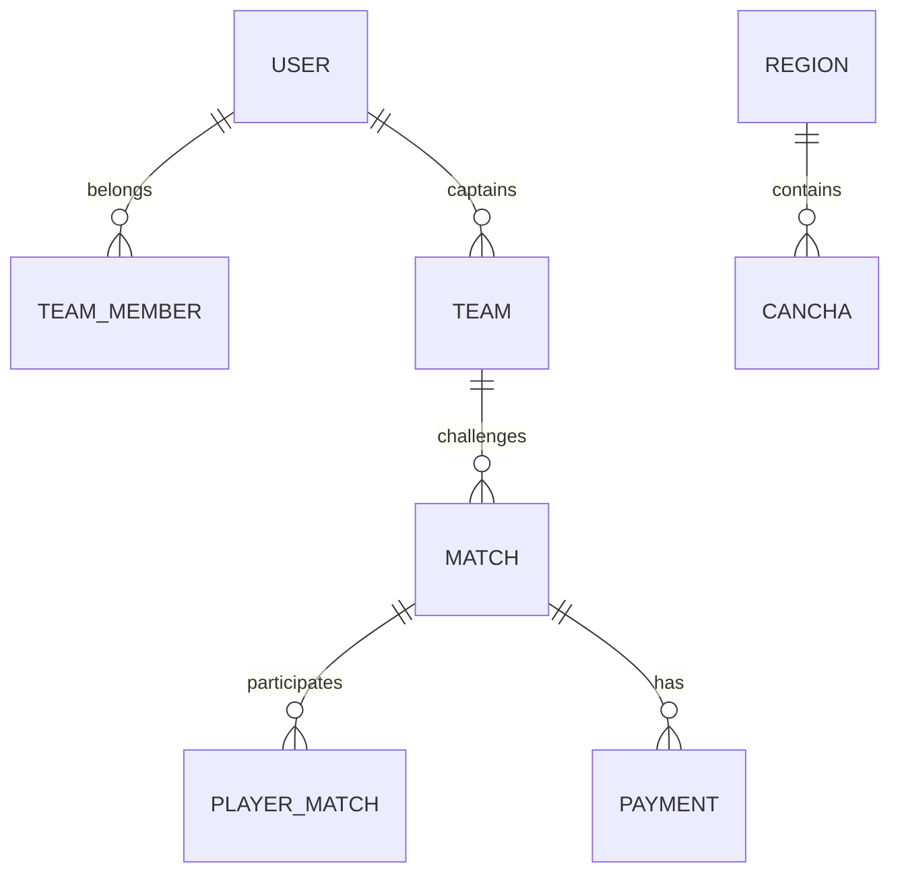

# 🚀 MatchDay API

> **"El motor de alto rendimiento detrás de la competición."**


<div align="center">


</div>

---

## 📖 Sobre el Proyecto

**MatchDay API** es el núcleo transaccional del ecosistema MatchDay. Construida con un enfoque en la asincronía y el alto rendimiento, esta API gestiona desde la autenticación biométrica/social hasta la orquestación en tiempo real de resultados y pagos para ligas de fútbol amateur.

Como parte del equipo de **TecnoRed**, hemos diseñado esta infraestructura para ser escalable, segura y fácil de integrar, utilizando estándares modernos de la industria como **OpenAPI (Swagger)** y **JSON Web Tokens (JWT)**.

---

## ⚙️ Arquitectura y Tecnologías Core

### Backend Engine: FastAPI
Elegido por su velocidad (basado en Starlette y Pydantic) y su capacidad nativa para manejar operaciones asíncronas (`async/await`), crucial para la gestión de múltiples peticiones simultáneas durante picos de tráfico en días de partido.

### Capa de Datos: SQLAlchemy & PostgreSQL
*   **SQLAlchemy 2.0:** Implementamos el patrón Data Mapper para mantener la lógica de negocio separada del esquema de la base de datos.
*   **PostgreSQL:** Motor relacional robusto que garantiza la integridad de los datos de pagos y resultados mediante transacciones ACID.

### Seguridad y Notificaciones
*   **JWT Auth:** Sistema de autenticación stateless para sesiones móviles seguras.
*   **Firebase Admin SDK:** Integración profunda para el envío de notificaciones push transaccionales (retos, confirmaciones de pago, cambios en el marcador).
*   **Bcrypt:** Hasheo de contraseñas con salting dinámico para la máxima seguridad en registros locales.

---

## 🗺️ Mapa de Módulos (API Surface)

La API está dividida en micro-servicios lógicos para facilitar el mantenimiento:

| Módulo | Responsabilidad |
| :--- | :--- |
| **`Auth`** | Gestión de identidades (Login Google, Registro Local, Recuperación). |
| **`Teams`** | Orquestación de equipos, membresías y transferencias de capitanía. |
| **`Matches`** | Ciclo de vida del partido: Publicación, Retos, Configuración y Ready check. |
| **`Payments`** | Validación de comprobantes y flujo de caja entre organizadores y capitanes. |
| **`Rankings`** | Motor de estadísticas que calcula el Leaderboard global. |
| **`Catalogs`** | Gestión geográfica (Regiones) y deportiva (Canchas/Google Maps). |

---

## 📊 Modelo de Datos (Resumen)



---

## 🚀 Despliegue y Desarrollo

### Prerrequisitos
*   Python 3.10+
*   Instancia de PostgreSQL activa.
*   Archivo `.env` configurado (DB_URL, Firebase Credentials, Secret Keys).

### Configuración Local

1.  **Clonar el repositorio:**
    ```bash
    git clone https://github.com/MatchDay-UCAB/matchday_backend.git
    cd matchday_backend
    ```

2.  **Crear y activar entorno virtual:**
    ```bash
    python -m venv venv
    source venv/bin/activate  # En Windows: venv\Scripts\activate
    ```

3.  **Instalar dependencias:**
    ```bash
    pip install -r requirements.txt
    ```

4.  **Ejecutar servidor de desarrollo:**
    ```bash
    uvicorn app.main:app --reload --port 8000
    ```

### Documentación Interactiva
Una vez ejecutado el servidor, puedes acceder a la documentación auto-generada:
*   **Swagger UI:** `http://localhost:8000/docs`
*   **ReDoc:** `http://localhost:8000/redoc`

---

<div align="center">
  <sub>Desarrollado como Pasante de <b>TecnoRed @ UCAB</b> - 2026</sub>
  <br>
  <small>Infraestructura de Datos de Alto Rendimiento</small>
</div>
